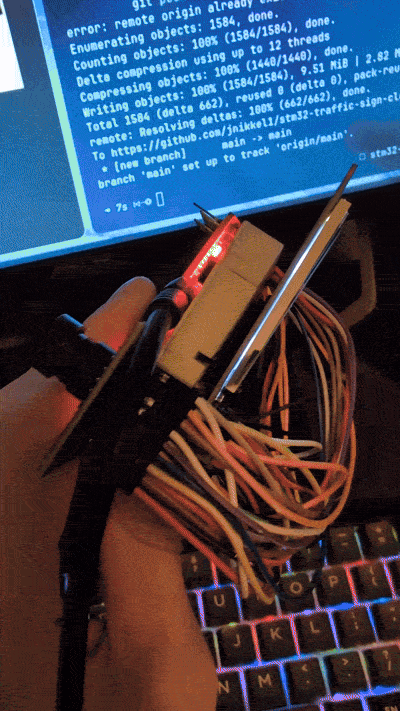

# Real-Time Embedded Traffic Sign Recognition (STM32 + Edge AI)

## 📌 Overview
A bare-metal, real-time computer vision and machine learning pipeline built on the **STM32F446RE (Cortex-M4F)**. This project captures live video from an **OV7670** camera via DCMI, preprocesses the image using custom signal processing, and classifies German Traffic Signs (GTSRB) using an **INT8 Quantized Convolutional Neural Network (CNN)** accelerated by **X-CUBE-AI**—all running entirely on the edge.

The system processes `48x48` RGB images and outputs predictions at **~11.5 FPS (87 ms inference latency)**, displaying the live video feed and confidence metrics on an ST7735 SPI TFT display.

## 🚀 Key Technical Highlights
This project required solving several low-level embedded challenges across memory management, peripheral concurrency, and digital signal processing:

* **Resolved AHB Bus Contention (DMA/SPI):** Synchronized simultaneous high-speed DCMI camera capture and SPI LCD streaming on the same DMA2 controller by manipulating stream priorities (`VERY_HIGH` for DCMI) and disabling FIFO buffering to enforce single-word flushes, preventing hardware overrun (`OVRRI`) errors.
* **Custom Camera ISP & Driver Development:** Wrote a bit-banged SCCB (I2C) driver to manually configure the OV7670's Image Signal Processor (ISP) registers. Tuned the YUV-to-RGB565 color matrix, disabled AWB to lock exposure, and implemented QQVGA hardware windowing and downsampling.
* **Anti-Aliasing & Auto-Contrast DSP:** Designed a C-based 2x2 box-filter to spatially downsample the 96x96 Region of Interest (ROI) into a 48x48 input tensor. Implemented dynamic auto-contrast stretching and saturation boosting to compensate for monitor backlight glare and sensor underexposure without altering hue.
* **Memory & Stack Optimization:** Operated within strict MCU constraints (128 KB SRAM, 512 KB Flash). Adjusted the `.ld` linker script to allocate an 8KB stack, preventing silent HardFaults during deep neural network convolutions, and utilized quantized `int8` data types to shrink model size to ~150 KB.
* **Bare-Metal UI Rendering:** Built a zero-dependency, DMA-driven 5x7 ASCII bitmap font renderer to overlay real-time classification text directly onto the SPI display's video feed buffer.

## 🧠 Machine Learning Pipeline
The model was trained from scratch in Python and deployed to C using ST's X-CUBE-AI middleware.
* **Dataset:** GTSRB (German Traffic Sign Recognition Benchmark), 43 classes.
* **Architecture:** Custom VGG-style CNN (`Conv2D` -> `BatchNorm` -> `ReLU6`). Flattened spatially at a `3x3` receptive field to preserve structural layouts of pictograms (e.g., numbers, bicycles).
* **Augmentation:** Applied custom photometric (brightness, saturation, noise, RGB565 bit-depth quantization) and geometric augmentations to simulate real-world OV7670 optical degradation.
* **Quantization:** Exported to TensorFlow Lite using Post-Training Integer Quantization (PTQ) with a representative dataset to lock the input scale to `1.0` and zero-point to `-128`.

## ⚡ Performance Metrics
| Metric | Value |
| :--- | :--- |
| **MCU** | STM32F446RE (ARM Cortex-M4F @ 180 MHz) |
| **Model Size (Flash)** | ~150 KB (INT8 Quantized) |
| **Peak RAM (Activations)** | ~25 KB (in `.bss`) |
| **Inference Time** | 87 ms per frame (~11.5 FPS) |
| **Accuracy** | 96% on representative GTSRB validation track |

## 🔌 Hardware Pinout (Nucleo-F446RE)

| Peripheral | Component Pin | STM32 Pin | Note |
| :--- | :--- | :--- | :--- |
| **OV7670 (DCMI)** | D0 - D7 | PC6-9, PB6, PE5-6, PC7 | 8-bit Parallel Video Data |
| | PCLK | PA6 | Pixel Clock |
| | HREF | PA4 | Horizontal Sync |
| | VSYNC | PB7 | Vertical Sync |
| | XCLK | PA8 (MCO1) | 24 MHz System Clock out |
| **OV7670 (SCCB)**| SIOD / SIOC | PC9 / PC8 | Bit-banged I2C Control |
| **ST7735 (SPI1)** | SCK / SDA | PA5 / PA7 | SPI Clock and MOSI |
| | CS / DC / RST | PA4 / PA9 / PA10 | Control Pins |

## 🛠️ Build Instructions
1. Clone this repository: `git clone https://github.com/YourUsername/stm32-traffic-sign-recognition.git`
2. Open the `firmware/` folder as a workspace in **STM32CubeIDE**.
3. Build the project (`Ctrl+B`) and flash to the Nucleo-F446RE.
4. Point the camera at a physical traffic sign (or a dimmed LCD monitor displaying a sign), and the classification will appear at the top of the screen.
